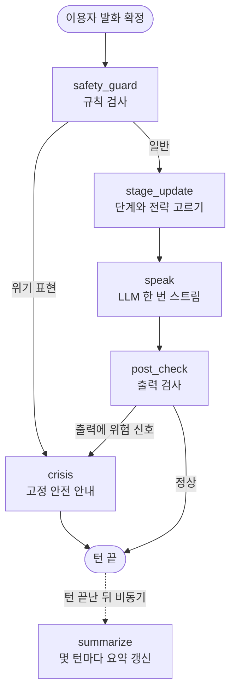
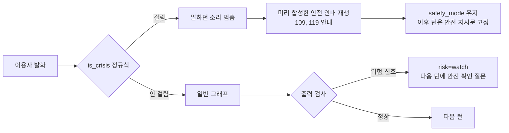

# LangGraph 도입 설계: 상담 음성 파이프라인

- 작성: 2026-11-02 (Grok)
- 상태: 설계안. 코드는 아직 바꾸지 않았다.
- 대상: `src/voice_pipeline` (web 앱 `voice_pipeline.web`)
- 관련 문서: `docs/plans/상담데이터_번역계획_20261102.md`, `docs/LEGAL_REVIEW.md`, `docs/dev-guide.md`

## 1. 목적

1. 한 턴의 답을 더 짧게 만든다. 답이 짧으면 TTS가 빨리 끝나고, 이용자가 다시 말할 차례도 빨리 온다.
2. 상담 흐름을 눈에 보이는 단위(공감, 질문, 요약, 위기 안내)로 나눈다. 지금은 시스템 프롬프트 한 덩어리가 모든 일을 맡는다.
3. 위기 표현을 LLM 앞에서 먼저 걸러, 모델 출력과 상관없이 안전 안내가 나가게 한다.
4. 세션 단계(처음, 탐색, 위로, 정리)를 상태로 들고 다녀서 단계마다 말하는 방식을 바꾼다.

이 문서의 범위는 비상업 데모다. 의료 행위가 아니라는 경계(LEGAL_REVIEW §5)는 그대로 지킨다.

## 2. 현재 구조 요약

코드를 읽고 확인한 내용이다.

| 부분 | 파일 | 지금 하는 일 |
|---|---|---|
| LLM 호출 | `llm/openai_stream.py` | vLLM `/chat/completions`를 스트림으로 부른다. 기본 `max_tokens=256`, `temperature=0.7`. 1차 64토큰, 2차 최소 192토큰으로 나누는 함수가 있다. |
| 시스템 프롬프트 | `llm/openai_stream.py` (`DEFAULT_SYSTEM_PROMPT`, `PROMPT_NO_FILLER`) | 고령 이용자 말동무, 존댓말, 짧은 공감 한 문장으로 시작, 전체 세 문장 안, 질문은 하나, 진단과 약 권유 금지, 죽고 싶다는 말에는 109와 119 안내. |
| 어조 참고 | `llm/hint.py` | 목소리와 표정 감정 태그를 한 줄 지시로 바꿔 시스템 프롬프트 뒤에 붙인다. 이번 턴에만 쓴다. |
| 청크 나누기 | `chunker.py` | 첫 청크는 8자 이상이면 쉼표에서도 끊고, 이후는 문장 끝에서 끊는다(15자에서 40자). |
| 턴 실행 | `pipeline.py` | `_produce_llm`이 토큰을 받아 청크로 큐에 넣고, `_consume`이 CosyVoice3로 합성해 싱크로 보낸다. 끼어들기(barge-in), 선행 생성(prepare/commit), 들은 만큼만 history에 남기기가 이미 있다. |
| 위기 처리 | `intent.py`, `pipeline.py` | `is_crisis()` 정규식은 위기 표현을 명령으로 오인하지 않게 막는 데만 쓴다. `pipeline.py`는 `RiskUpdate("119")`를 받으면 말을 끊고 `SAFETY_TEXT_119`를 읽는다. |
| 고정 안내 음성 | `prompts.py` | 법적 고지, 인사, 확인 질문을 미리 합성해 둔다. |

확인한 빈틈:

- 실제 LLM 클라이언트(`OpenAIStreamLLM.stream`)는 늘 `Meta(risk_grade="일반")`만 낸다. `RiskUpdate`를 내는 곳은 mock뿐이다. 그래서 지금 실제 운용에서 위기 대응은 시스템 프롬프트 문장 하나에 달려 있다.
- 답 길이는 프롬프트 문장("세 문장 안")과 `max_tokens=256`로만 묶여 있다. 256토큰이면 한국어로 꽤 긴 답도 나올 수 있다.
- 세션 단계라는 개념이 없다. 첫 턴과 열 번째 턴이 같은 지시를 받는다.

## 3. 제안 그래프

### 3.1 원칙

- 한 턴에 LLM 스트림 호출은 한 번만 한다. 노드를 여럿 두되, 대부분은 규칙 기반 노드로 만들고 말을 만드는 노드는 하나로 둔다.
- 끼어들기, 선행 생성, 들은 만큼 남기기는 지금 `pipeline.py`가 잘 하고 있으니 그대로 둔다. LangGraph는 "이번 턴에 무엇을 어떻게 말할지" 정하는 부분만 맡는다.
- 토큰은 LangGraph `custom` 스트림 모드(`get_stream_writer`)로 내보낸다. 우리 LLM 클라이언트는 LangChain 채팅 모델이 아니기 때문이다. 공식 문서도 LangChain 통합이 없는 LLM에는 `custom` 모드를 쓰라고 안내한다.

### 3.2 그래프 모양



### 3.3 노드

| 노드 | LLM 호출 | 하는 일 |
|---|---|---|
| `safety_guard` | 없음 | `intent.is_crisis()`를 이용자 발화에 돌린다. 걸리면 `risk="crisis"`로 두고 바로 `crisis`로 간다. 5ms 안에 끝난다. |
| `stage_update` | 없음 | 턴 수, 직전 전략, 감정 태그, 발화 길이로 단계와 이번 턴 전략을 고른다(4절 규칙). 전략에 맞는 짧은 지시문과 `max_tokens`를 상태에 넣는다. |
| `speak` | 1회 (스트림) | 기본 시스템 프롬프트 + 전략 지시문 + 요약 + 최근 몇 턴으로 vLLM을 부른다. 토큰을 `custom` 스트림으로 바로 내보내 기존 청커와 TTS로 흘린다. |
| `post_check` | 없음 | 생성된 문장에 진단명, 약 이름, "치료" 같은 금지 표현이나 위험 신호가 있는지 정규식으로 본다. 이미 소리로 나간 뒤라 막을 수는 없으므로, 기록하고 다음 턴 지시를 고친다. 위험 신호면 `crisis`로 보낸다. |
| `crisis` | 없음 (기본) | `PromptBank`에 미리 합성한 안전 안내를 재생한다. 지금의 `_safety_stop` 흐름과 같은 길을 쓴다. |
| `summarize` | 1회 (턴 밖) | 4턴에서 6턴마다, 이용자가 말하는 동안이 아닌 빈 시간에 짧은 요약을 만든다. 턴 지연에 들어가지 않는다. |

공감, 질문, 요약을 노드 셋으로 나누어 각각 LLM을 부르는 방식은 쓰지 않는다. 호출이 세 번이면 첫 토큰까지 걸리는 시간이 늘고, 답이 오히려 길어진다. 대신 "이번 턴은 공감만", "이번 턴은 질문 하나" 식으로 전략을 고르고 말하는 노드 하나가 그 전략대로 짧게 말한다. ESConv 논문도 전략을 먼저 정하고 그 전략에 맞춰 답을 만드는 방식(전략 토큰)을 썼다.

### 3.4 상태

```python
class TurnState(TypedDict):
    session_id: str          # LangGraph thread_id로 쓴다
    user_text: str
    hint: str                # llm/hint.py 결과
    turn_index: int
    stage: Literal["opening", "explore", "comfort", "wrapup"]
    strategy: Literal["reflect", "question", "affirm", "summary", "suggest", "info"]
    last_strategies: list[str]   # 최근 3개
    summary: str             # summarize 노드가 갱신
    risk: Literal["normal", "watch", "crisis"]
    max_tokens: int
    reply_text: str          # 실제로 들은 부분은 pipeline이 따로 남긴다
```

대화 기록(history)은 지금처럼 `VoicePipeline.history`가 주인이다. 끼어들기나 "방금 말 지워 줘"(REDO_USER)로 history가 되돌아가는 경우가 있어서, 그래프 상태에 같은 기록을 두 벌 두면 어긋나기 쉽다. 그래프 상태에는 단계, 전략, 요약, 위험 수준만 둔다.

체크포인터는 데모에서는 `InMemorySaver`로 충분하다. 공식 문서 설명대로 프로세스를 다시 띄우면 사라지는데, 데모 세션은 원래 재시작하면 새로 시작하므로 문제가 없다. 세션이 끝나거나 RESET이면 thread를 버린다.

## 4. 단계와 전략 고르기

ESConv의 세 단계(탐색, 위로, 실행)와 전략 분포를 바탕으로 하되, 고령 이용자 말동무라는 쓰임에 맞게 줄였다. ESConv 분석에서 상담자는 앞부분에 질문을 많이 하고, 상황을 안 뒤에 제안을 하며, 위로는 대화 내내 고르게 썼다. 전략 이동도 "질문, 위로, 질문"이 가장 흔했다.

| 단계 | 들어가는 조건 | 고를 수 있는 전략 |
|---|---|---|
| opening | 1턴에서 2턴 | reflect, question |
| explore | 기본 | reflect, question, affirm |
| comfort | 부정 감정 태그가 2턴 이어짐, 또는 이용자가 길게 털어놓음 | reflect, affirm |
| wrapup | 세션 종료 확인 직전, 또는 12턴 이상 | summary, suggest(병원이나 상담센터 안내 정도) |

규칙:

1. 질문은 두 턴 연속 하지 않는다. MI 연구에서 질 좋은 상담은 되짚기(reflection)와 질문 비율이 1 안팎이었다(AnnoMI). 질문만 이어지면 심문처럼 들린다.
2. 이용자 발화가 아주 짧으면(예: "네", "그냥요") 질문 하나로 문을 연다.
3. `suggest`와 `info`는 wrapup에서만 쓰고, 진단이나 약 이야기는 어떤 전략에서도 하지 않는다.
4. 규칙으로 먼저 시작하고, 나중에 번역 데이터의 전략 라벨로 작은 분류기를 만들 수 있다(7절).

## 5. 답변 길이 정책

| 전략 | 문장 수 | 대략 글자 수 | `max_tokens` (첫 값, 측정 후 조정) |
|---|---|---|---|
| reflect | 1에서 2 | 40자 안 | 48 |
| question | 1 (짧은 공감 덧붙이면 2) | 40자 안 | 48 |
| affirm | 1에서 2 | 45자 안 | 56 |
| summary | 2 | 70자 안 | 80 |
| suggest, info | 2 | 70자 안 | 80 |
| crisis | 고정 문장 | 고정 | LLM 안 씀 |

- `max_tokens`는 안전망이다. 문장 중간에서 잘리면 어색하므로, 길이는 지시문으로 맞추고 `max_tokens`는 그보다 조금 넉넉하게 둔다. 잘렸을 때는 청커가 마지막 문장 끝까지만 내보내도록 한다.
- Qwen 토크나이저에서 한국어 한 글자가 몇 토큰인지는 아직 재지 않았다. 1단계에서 실제 답 100개로 재고 위 숫자를 고친다.
- 지시문은 짧게 쓴다. 시스템 프롬프트가 길수록 prefill이 늘어 첫 토큰이 늦어진다.

## 6. 지연 시간 예산과 호출 수 줄이기

공개 자료의 기준은 이렇다. Twilio는 2025년 11월 기준 단순 캐스케이드 음성 에이전트의 목표를 LLM 첫 토큰 375ms(상한 750ms), TTS 첫 소리 100ms(상한 250ms), 입에서 귀까지 1,115ms(상한 1,400ms)로 잡았다. Soniox 자료는 사람이 말을 끝낸 뒤 대답이 들릴 때까지 800ms 안팎을 목표로 보고, 체감 지연은 전체 답 생성 시간보다 첫 토큰과 첫 소리에 달렸다고 설명한다.

HealthUp 턴 예산 초안(이용자 발화 끝에서 첫 소리까지):

| 구간 | 목표 | 비고 |
|---|---|---|
| 끝점 판단 | 기존 smart_turn 값 유지 | 이번 설계 범위 밖 |
| Qwen3 ASR 확정 | 기존 값 유지 | |
| 그래프 규칙 노드 (`safety_guard`, `stage_update`) | 10ms 안 | 정규식과 표 조회만 |
| LangGraph 자체 오버헤드 | 20ms 안 | 1단계에서 잰다 |
| LLM 첫 토큰 | 400ms 안 | 프롬프트를 줄여 prefill을 줄인다 |
| 첫 청크 모으기 | 8자 이상 쉼표 | 기존 청커 |
| CosyVoice3 첫 소리 | 기존 값 유지 | 맞장구(backchannel)가 빈틈을 메운다 |

호출 수를 줄이는 방법:

1. 말을 만드는 LLM 호출은 턴마다 한 번. 공감과 질문을 따로 부르지 않는다.
2. 위기 판단은 규칙으로 먼저 한다. LLM 분류기를 앞에 두면 첫 토큰이 한 번의 왕복만큼 늦어진다.
3. 요약은 턴이 끝난 뒤 빈 시간에 만든다. 이용자가 말을 시작하면 요약 작업은 취소한다(같은 vLLM을 쓰므로 말하는 턴과 다투지 않게).
4. 대화 전체 대신 요약 + 최근 4턴만 넣어 프롬프트 길이를 일정하게 묶는다.
5. 기존 1차 64토큰, 2차 192토큰 나누기는 짧은 답 정책과 겹치므로, 그래프 도입 뒤에는 한 번 호출로 합친다.
6. vLLM prefix caching이 켜져 있다면 시스템 프롬프트 앞부분을 고정 문장으로 두어 캐시가 잘 맞게 한다. 지금 서버 설정은 이 문서에서 확인하지 않았다.

## 7. 위기 대응 흐름



- 1차 방어는 규칙이다. 지금 `intent.py`의 `_CRISIS_PATTERNS`를 그대로 쓰고, 상담 흐름에서도 쓰도록 연결한다. 이것만으로 "실제 운용에서 RiskUpdate가 나오지 않는다"는 빈틈이 메워진다.
- 안전 안내 문장은 지금의 `SAFETY_TEXT_119`와 시스템 프롬프트 지침(먼저 마음을 알아주고, 안전한지 묻고, 109를 알리고, 급하면 119)을 따른다. 안내 뒤에도 대화를 끊지 않는다. 임상 지침을 적용한 연구(arXiv 2510.27521)에서는 위험 신호가 쌓일수록 모델이 대화를 이어 가자는 말을 덜 했고, 연구진은 이것이 도움 요청을 꺾을 수 있다고 지적했다.
- 안전 모드에서는 `speak` 노드가 "공감, 안전 확인, 연락처 안내" 지시문만 쓴다. 단계 규칙은 멈춘다.
- 정규식이 놓치는 돌려 말하기("다 끝내고 싶어요" 같은 말)는 2단계 과제로 둔다. 후보는 작은 분류 모델이나, 턴 밖에서 도는 LLM 판정이다.
- 평가는 VERA-MH 루브릭의 다섯 축(위험 알아차림, 위험 확인, 사람 도움으로 안내, 지지하는 대화, AI 한계 지키기)을 한국어로 옮겨 시나리오 20개에서 30개로 돌린다.

## 8. 튜닝 데이터와의 연결

`상담데이터_번역계획_20261102.md`에서 번역하는 데이터 가운데 그래프 설계에 바로 쓸 수 있는 부분:

| 데이터 | 쓰는 곳 |
|---|---|
| ESConv (전략 라벨 8종, 단계 구조) | `stage_update` 전략 표의 근거, 나중에 전략 분류기 학습. 번역 계획 3절 규칙 3대로 전략 이름은 번역하지 않고 표로 바꾸므로 라벨을 그대로 쓸 수 있다. |
| AnnoMI (되짚기와 질문 라벨, 질 좋은 MI와 나쁜 MI 구분) | reflect, question 전략의 예시 문장, 질문 비율 규칙 점검 |
| Psych8k (ChatCounselor), CPsyCoun, SMILE | `speak` 노드 튜닝 데이터. 다만 원래 답이 길어 그대로 쓰면 긴 답을 배운다. 전략별 길이 상한(5절)에 맞춰 잘라 낸 버전을 따로 만든다. |
| MentalChat16K | 응답이 길다는 메모가 있으므로 짧게 다시 쓴 뒤에만 쓴다. |
| 번역 계획 3절 4번의 위기 표시 대화 | 위기 정규식의 놓친 표현 찾기, 안전 모드 평가 시나리오 |

튜닝 입력 형식은 "전략 지시문 + 대화"로 맞춘다. 그래야 추론할 때 `stage_update`가 넣는 지시문과 학습 분포가 같아진다.

## 9. 단계별 도입 순서

| 단계 | 내용 | 끝났다고 보는 기준 |
|---|---|---|
| 0 | 지금 상태 측정: 답 글자 수, 첫 토큰, 첫 소리, 한 턴 전체 재생 시간 (기존 trace 사용) | 기준 수치표 |
| 1 | 위기 규칙을 상담 흐름에 연결 (그래프 없이도 가능). 실제 LLM 경로에서 `RiskUpdate`를 낸다. | 위기 문장 30개에서 놓침 0건, 오탐 기록 |
| 2 | 전략 지시문과 길이 정책만 프롬프트에 넣기 (아직 그래프 없음) | 평균 답 길이 40% 이상 감소, 이용자 체감 평가 유지 |
| 3 | LangGraph 붙이기: `safety_guard`, `stage_update`, `speak`, `crisis`. `custom` 스트림으로 기존 청커에 연결. 별도 브랜치와 설정 플래그로 끄고 켤 수 있게 한다. | 기존 테스트 통과, 그래프 오버헤드 20ms 안 |
| 4 | `summarize`와 `post_check` 추가 | 15턴 대화에서 프롬프트 길이 일정, 요약 작업이 턴과 겹치지 않음 |
| 5 | 번역 데이터로 튜닝한 모델을 `speak`에 연결, 전략 분류기 실험 | 번역 검수 4점 이상 데이터만 사용 |

2단계에서 목표를 거의 이룰 수도 있다. 그렇다면 LangGraph 없이 작은 상태 기계로 끝내는 쪽도 열어 둔다.

## 10. 위험과 남은 결정

위험:

- 의존성 추가: `langgraph`와 그 의존 패키지가 들어온다. 지금 코드는 `aiohttp`로 vLLM을 직접 부르는 가벼운 구조라, 설치 크기와 버전 관리 부담이 생긴다.
- 끼어들기와의 충돌: 그래프 실행 도중 태스크가 취소되면 상태 갱신이 반쯤 남을 수 있다. 그래프는 턴이 확정(commit)된 뒤에만 상태를 쓰게 한다.
- interrupt 기능은 사람 승인 흐름용이다. 노드를 처음부터 다시 실행하는 방식이라 음성 끼어들기에는 맞지 않는다. 끼어들기는 기존 `TurnGuard`로 처리한다.
- 짧은 답이 차갑게 들릴 수 있다. MI 챗봇 연구(Aimi)에서는 반대로 "되짚기가 많고 길다"는 이용자 의견이 나왔다. 둘 사이 균형은 사람이 들어 보고 정해야 한다.
- 규칙 위기 탐지는 돌려 말한 표현을 놓친다.

남은 결정:

1. LangGraph를 실제로 쓸지, 2단계 결과를 보고 작은 상태 기계로 끝낼지.
2. 전략 고르기를 규칙으로만 할지, 나중에 분류기를 둘지.
3. 전략별 `max_tokens` 숫자 (토큰 측정 뒤 확정).
4. 요약 주기(4턴인지 6턴인지)와, 요약을 같은 Qwen3.8-27B로 만들지 더 작은 모델로 만들지.
5. 안전 모드에 들어간 뒤 언제 풀지 (세션 끝까지 유지할지).
6. 체크포인터를 메모리로 둘지, 보호자 보고서용으로 SQLite에 남길지 (남긴다면 개인정보 검토 필요).
7. 위기 평가 시나리오를 누가 검수할지.

## 11. 참고문헌

LangGraph 문서
- LangGraph Streaming: https://docs.langchain.com/oss/python/langgraph/streaming
- LangGraph Persistence (checkpointer, store): https://docs.langchain.com/oss/python/langgraph/persistence
- LangGraph Interrupts: https://docs.langchain.com/oss/python/langgraph/interrupts

상담 대화 구조와 데이터
- Liu et al., Towards Emotional Support Dialog Systems (ESConv), ACL 2021: https://arxiv.org/abs/2106.01144
- Liu et al., ChatCounselor: A Large Language Models for Mental Health Support (Psych8k): https://arxiv.org/abs/2309.15461
- Zhang et al., CPsyCoun: A Report-based Multi-turn Dialogue Reconstruction and Evaluation Framework for Chinese Psychological Counseling: https://arxiv.org/abs/2405.16433
- Qiu et al., SMILE: Single-turn to Multi-turn Inclusive Language Expansion via ChatGPT for Mental Health Support: https://arxiv.org/abs/2305.00450
- Creation, Analysis and Evaluation of AnnoMI, a Dataset of Expert-Annotated Counselling Dialogues: https://doi.org/10.3390/fi15030110
- Structured Large Language Model Workflows for Motivational Interviewing in Health Behavior Change (Aimi), JMIR Formative Research 2026: https://formative.jmir.org/2026/1/e94036

위기 탐지와 안전 평가
- AI Chatbot Suicide Risk Detection and Response: Human Validation Study of the Open-Source VERA-MH Safety Evaluation: https://arxiv.org/abs/2602.05088 (JMIR AI판: https://ai.jmir.org/2026/1/e92817)
- VERA-MH 코드: https://github.com/SpringCare/VERA-MH
- Independent Clinical Evaluation of General-Purpose LLM Responses to Signals of Suicide Risk: https://arxiv.org/abs/2510.27521

음성 지연 시간
- Twilio, Core Latency in AI Voice Agents: https://www.twilio.com/en-us/blog/developers/best-practices/guide-core-latency-ai-voice-agents
- Soniox, The voice agent latency budget: https://soniox.com/wiki/voice-agent-latency-budget
